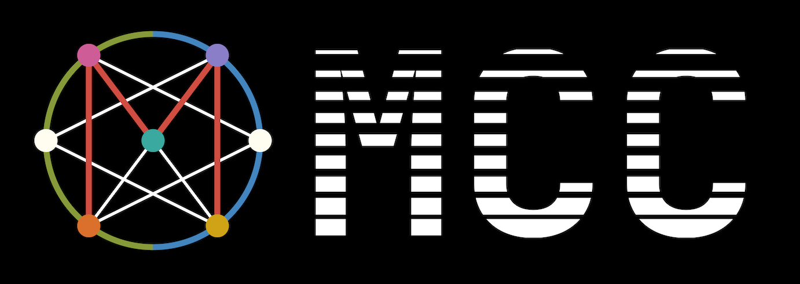

# Team Handbook

The [National Cyber League (NCL)](https://cyberskyline.com/events/ncl) is an online competition for cybersecurity students and professionals.

## Index

1. [Competition Guide](competition-guide.md) - **Start here!**
2. [Creating Your Lab](lab-guide.md)
3. Categories

	- [Open Source Intelligence (OSINT)](categories/osint.md)
	- [Cryptography](categories/cryptography.md)
	- [Log Analysis](categories/log-analysis.md)
	- [Network Traffic Analysis](categories/network-traffic-analysis.md)
	- [Forensics](categories/forensics.md)
	- [Password Cracking](categories/password-cracking)
	- [Enumeration and Exploitation](categories/enumeration-and-exploitation.md)
	- [Web Application Security](categories/web-application-security.md)

## Additional Links

[Cyber Skyline Trove](https://trove.cyberskyline.com/) | [Practice Gym Guides](https://trove.cyberskyline.com/a310b9e0d84f47038911db4f48a8beb5)

## Authors

[Rowan Weir](https://github.com/rowanweir)
